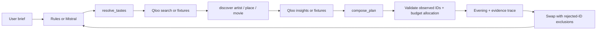

# Afterglow

**Go where your taste takes you.** An evening-planning agent that connects the music, films and creators you love to a new soundtrack, dinner spot and film.

[Try the public demo](https://schultzenator.github.io/afterglow-qloo/) · [Submission kit](SUBMISSION-KIT.md) · [Work state](WORK-STATE.md)

The hosted GitHub Pages demo is **key-free, curated fixtures + a rule-based tool workflow**. It does not call Qloo or an LLM. A Node/Cloudflare backend implements live Qloo and optional Mistral function calling behind the same tools. Qloo live integration still needs an API key and a credentialed smoke test before submission. This distinction is also visible inside the app.

## Try it in 60 seconds

1. Open the demo. The default brief mentions Khruangbin, Wes Anderson and Haruki Murakami.
2. Choose New York, London or Warsaw, a total group budget in USD, and party size.
3. Click **Find my evening**. Open **Why this fits** on any recommendation.
4. Open **Follow the agent's trail** to inspect inputs and outputs.
5. Swap the film using its circular-arrow button. The rejected ID enters exclusions; the UI retains the other two choices and records the merge.
6. Click **Save evening** to download a Markdown itinerary, or try another mood and toggle **A little outside my usual**.

No sign-up or payment. Times are suggested; no table, ticket or streaming entitlement is booked. Budget numbers are group allocations, not prices. Restaurants and media in fixtures are illustrative; check details directly.

## Run locally

Node **22.12+** (Docker uses Node 22).

```bash
npm ci
npm run dev
```

Open the Vite URL. If no backend is present, it uses browser-local demo fixtures. The rule planner recognizes the example favorites and known catalog names; other favorite names can be put in double quotes, but must resolve in the selected provider. It is not a general natural-language constraint parser. Location, budget, party size and discovery mode are explicit controls.

For the backend (in another terminal):

```bash
cp .env.example .env
# Edit .env to add QLOO_API_KEY and optionally MISTRAL_API_KEY.
npm run server
```

The dev server proxies `/api` to port 4317. For a production Node server, build first and open `http://localhost:4317`:

```bash
npm run build
npm run server
```

| Server credentials | Taste data | Planner |
| --- | --- | --- |
| None | Curated fixtures | Rules |
| Qloo only | Qloo REST | Rules; quote arbitrary favorite names |
| Mistral only | Curated fixtures | Model-directed function calls |
| Qloo + Mistral | Qloo REST | Model-directed function calls |

If live Qloo fails, the server reports the failure. It never silently labels fixture picks as live data. Health mode detection and a manual demo fallback are separate from recommendation execution.

## How the agent works



The model selects tools and candidate IDs. The application executes them, validates arguments, and rejects invented IDs. The server enforces city, price tier and exclusions rather than trusting model-supplied filters. Qloo is the retrieval and ranking source; the model provides orchestration and short contextual explanations. Per-entity explainability, when returned, remains inspectable in the trace. Its absence is disclosed rather than reconstructed as a fake Qloo claim.

The rule planner calls the same registry. Its fixture ranking is a transparent tag overlap, not a simulation of Qloo's proprietary model. “Outside my usual” skips the top fixture match; live Qloo instead applies a popularity ceiling. It does not claim a measured novelty score.

Patterns adapted from the entrant's PayPal AgentCart: interchangeable mock/live gateways, a deterministic demo planner alongside an LLM tool loop, observable execution and substitution after feedback. Afterglow is a new implementation and has no payment integration.

## Qloo integration

`server/qloo.ts` calls `GET /search?query=…&take=5` and `GET /v2/insights` with `filter.type`, `signal.interests.entities`, seed/rejection exclusions and `feature.explainability=true`. Places additionally use city/locality and price-tier filters. Keys are sent only in a server-side `X-Api-Key` header. No secrets use a `VITE_` prefix. See [API contract and activation](docs/API-CONTRACT.md).

**TODO for PW:** obtain the Qloo key through the organizer's form, set it on a backend host, run a real plan, inspect the returned entities and confirm the public app shows **Live Qloo**. Do not submit the fixture demo as verified Qloo output.

## Deploy

GitHub Pages is automatically published on pushes to `main` by `.github/workflows/pages.yml`. It uses `VITE_STATIC_DEMO=1` and the repository base path. This stable, public fallback remains usable without paid services.

For a single-origin public app with live API calls, deploy the Worker and static assets together:

```bash
npm ci
npx wrangler login
npx wrangler secret put QLOO_API_KEY
# Optional, for model-directed planning:
npx wrangler secret put MISTRAL_API_KEY
npm run deploy:worker
```

Never build the Worker with `VITE_STATIC_DEMO=1`. Use the printed `workers.dev` URL as the live demo link. `QLOO_API_URL` defaults to `https://api.qloo.com`; use an allowed Qloo event origin only if the credential instructions specify it. The API is same-origin; no broad CORS endpoint is provided. Basic in-memory rate limits and bounded bodies are included; a production launch should use a shared edge limiter.

Docker alternative:

```bash
docker build -t afterglow .
docker run --rm -p 4317:4317 --env-file .env afterglow
```

The image runs as a non-root user and includes the built UI and TS backend. `.env` files are excluded from the image. Publish on any Node/Docker host; no database required.

## Validation

```bash
npm test
npm run build
npm run test:e2e
```

The browser tests default to `/usr/bin/google-chrome`; set `CHROME_PATH` if needed. `E2E_URL=https://…/` runs them against an existing deployment. Tests cover the core flow, mobile overflow, source disclosure, error recovery, swap continuity, downloads, ID grounding, ambiguous searches, API contracts and model/tool round trips. If the environment has an invalid temp-directory setting, prefix commands with `TMPDIR=/tmp`.

AI-assisted development: Codex helped implement, test and document this project. The runtime agent is the product; the hosted fixture demo explicitly uses rules. MIT license. No generated photos or third-party poster artwork; the visual assets are original SVG/CSS compositions. Google Fonts are optional and have system fallbacks.
